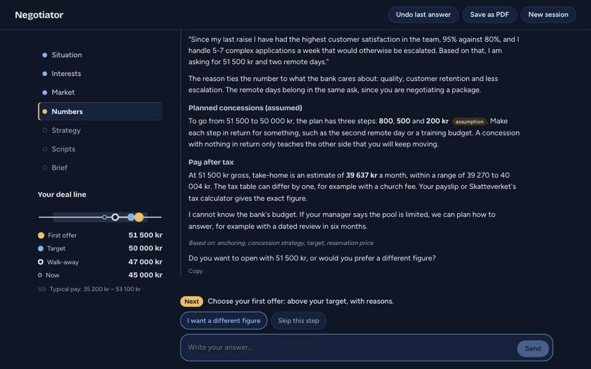
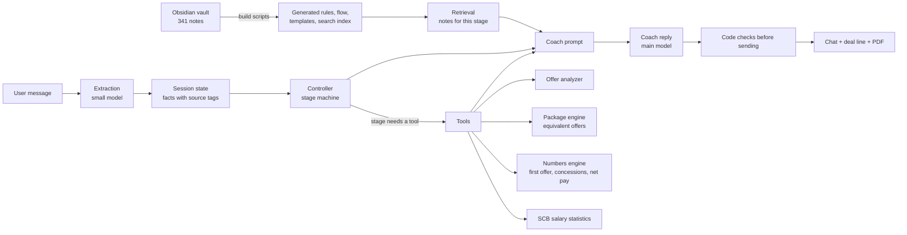

# Negotiator: a salary negotiation coach for Sweden

Negotiator takes you through preparing for a salary conversation, step by step, and ends with a plan you can bring to the meeting. That plan covers your target, your first offer, a three-step concession plan, packages to offer, your arguments and the exact words to use.

It works for a **new job offer** and for a **raise at your current job**, in **Swedish and English**. The advice comes from a knowledge base I built from the Negotiation course at NTU Singapore, adapted to Swedish working life (collective agreements, occupational pension, SCB pay statistics, Swedish tax tables).

**Live demo:** [negotiator-pearl.vercel.app](https://negotiator-pearl.vercel.app). This is a test version, and the access code is available on request.

**Watch a session (2 min):** [docs/negotiator-demo.mp4](docs/negotiator-demo.mp4). It shows a real session on the live site, from the first message to the saved PDF.



## What a session looks like

1. **Situation:** a new job or a raise, role, experience, city and current pay or offer.
2. **Interests:** what matters to you and why, and whether you negotiate salary only or a whole package (vacation, remote days, pension, training, title, start date).
3. **Market:** your alternative if there's no deal (BATNA), your target and your walk-away come first. Then the app shows the market pay for your occupation group from SCB, Statistics Sweden.
4. **Numbers:** a first offer above your target, the walk-away, and how the deal usually lands between them.
5. **Strategy:** two or three packages that are worth the same to you but really differ, plus answers to the tough questions.
6. **Scripts:** what to say, in your channel and language, with optional practice of one tough question.
7. **Brief:** the plan, saved as a PDF.

You can skip any step, go back, or stop at any time.

## How it works



- **The knowledge base is the source of truth.** All rules, the conversation flow, the brief template and the coach's style are written as notes in an Obsidian vault. Build scripts turn them into code and a search index, so changing a note changes the product.
- **A stage machine decides what happens next, not the model.** Each stage has required facts, and the controller asks for at most two of them per turn. Tools run only when their inputs exist.
- **The model never does arithmetic.** First offers, concession steps, net pay after tax, pension estimates and package scoring all come from deterministic code. The model explains the results and can't change them.
- **Facts carry where they came from.** Every fact is tagged as said by the user, researched, computed or assumed. Assumptions are shown as assumptions and never fed into the numbers as if verified.
- **Code checks every reply before it is sent.** Every figure must trace back to the user, a note, the researcher or the engine. The checks also cover target figures before the numbers step, promises about the outcome, more than two questions at once, asks for ID or bank details, and anything that leaks internal notes.

## Design decisions I'm happy with

The full list is in the vault's Decisions-Log (116 decisions). A few that shaped the product:

| Decision | Why |
|---|---|
| Market pay comes from **SCB's official statistics first**. A cheap model only picks the occupation group, and the figures come straight from the API. | Exact, citable numbers instead of a model's guess. It also merges related titles, for example a mortgage advisor into SCB's bank staff group. |
| A pay range is shown **only where a source gives one**. An average alone is reported as an average, with low confidence. | An average and a median are not the same thing, and users act on these numbers. |
| **Your own view before the market**: your BATNA, target and walk-away are asked before any market figure is shown. | This avoids anchoring the user on the market number. |
| **First offer separate from target**, a little above it, so there is room to give. | Negotiators who open at their target end up below it. |
| **Concessions in three decreasing steps, each in exchange for something.** | Decreasing steps signal that you're nearing your limit, and trading instead of conceding keeps value. |
| **Packages that really differ** (MESO: multiple equivalent simultaneous offers), built by an engine from the user's points. | Early tests showed the model writing two nearly identical packages, which gives the employer no real choice and tells you nothing. |
| **Guesses are labelled as guesses**, with confidence in words and a reason, never a percentage. | False precision is worse than honest uncertainty. |
| **Nothing from users is stored.** The session lives in the browser; logs hold only counters with no content. | People type their pay and their employer. |
| **Keyword search, no embeddings (for now).** A free retrieval check showed that most misses came from filters, not from the search method. | Embeddings would add cost and another processor of user text, without fixing the real cause. |

## Tech

- **App:** Next.js 15 and TypeScript, hosted on Vercel with functions in Stockholm.
- **Models:** Claude Sonnet for the coach; Claude Haiku for extraction, picking the occupation group and judging evals. Prompt caching keeps the cost per session low.
- **PDF:** built in the browser with @react-pdf/renderer. The plan is created from the session without a model call.
- **Data:** SCB PxWebApi (table TAB5932, wage structure statistics), Skatteverket's 2026 tax tables, and pension agreement rates (ITP 1, SAF-LO, KAP-KL, AKAP-KR, PA 16).
- **Cost and abuse limits:** an access code, messages per hour per visitor, and a total cap per hour.

## Testing

- **370 automated tests** (Vitest). They cover the stage machine, the numbers, package and offer engines, the tax tables, SCB parsing, reply checks, the PDF plan, access limits, and making sure no server code reaches the browser.
- **An eval harness of 76 scripted cases** with code checks and a model judge, run as a manual GitHub workflow with a release gate.
- **A free retrieval check** for whether the right note is found for 32 known questions.
- **Manual end-to-end testing in both languages.** Several features came straight from it: the skip button, the plain-language PDF, and the package engine. Recording the demo video found three more bugs: free-text values the flow didn't recognise, a target saved as an object, and the session ending when the user said "I'm happy with" a figure. Each was fixed with a test that reproduces it.

## Run it locally

```
npm install
cp .env.example .env.local   # add your own ANTHROPIC_API_KEY
npm test
npm run dev                  # http://localhost:3000
```

The vault isn't in this repo. The generated files and the search index are committed, so the app runs without it.

## How it was built

I designed the product, wrote the knowledge base from my course material, made the design decisions and did the testing. The code was written with an AI coding agent (Claude Code) working from my specifications and decisions. That's also how I'd build software at work: I'm responsible for what it should do and why, and I check that it does.

## Limits

- The test version runs on Vercel's free plan and Anthropic's API. Paid use would need a hosting plan with a data processing agreement, and the provider checks noted on the privacy page.
- SCB figures are national, by occupation group. City, employer and seniority can move them, and the app says so.
- This is preparation support, not legal or financial advice.
